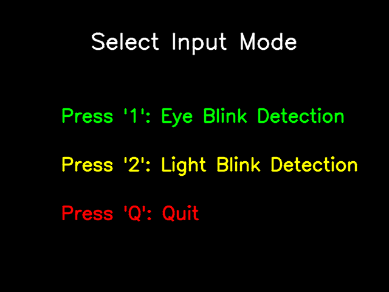

# CV Morse Decoder · LuminEye

A Python desktop application that converts eye blinks or blinking light into Morse code and decoded text. LuminEye combines OpenCV, MediaPipe face landmarks, and a YOLO light detector with a timed symbol selector and optional speech output.

## Screenshot



The application's mode-selection frame is shown above. Live eye and light detection views are omitted because they require camera input; no replacement camera images are used.

## Features

- Eye-blink input using MediaPipe Face Mesh and eye-aspect-ratio calibration.
- Light-blink input using the bundled YOLO model.
- A timed selector that cycles through dot, dash, and space phases.
- Morse decoding for letters A–Z and digits 0–9, with invalid-prefix feedback.
- A live text panel, keyboard editing controls, and text-to-speech output.
- Morse audio playback on Windows through `winsound`.

## Requirements

- Python 3.12 and the `uv` package manager for the installation commands below.
- A graphical desktop and an OpenCV build with GUI support; headless OpenCV cannot display this app.
- A working camera for either detection mode. The selection screen does not require one.
- A system speech engine for `pyttsx3`, such as eSpeak/eSpeak NG on Linux. Morse beeps use Windows-only `winsound` and are disabled on other platforms.
- The included model at `morse_decoder/assets/best.pt`.

The verified Python setup uses MediaPipe 0.10.21 and NumPy 1.x because the application calls MediaPipe's `solutions.face_mesh` API. CPU PyTorch is sufficient; CUDA is not required.

## Installation

```bash
git clone https://github.com/LedgeA/CV-Morse-Decoder.git
cd CV-Morse-Decoder
uv venv --python 3.12 .venv
uv pip install torch torchvision --index-url https://download.pytorch.org/whl/cpu
uv pip install -r requirements.txt "mediapipe==0.10.21" "numpy<2" "opencv-python<4.12" "opencv-contrib-python<4.12"
```

The extra version constraints preserve the APIs used by the existing code. `uv` reads the repository's UTF-16 requirements file directly.

## Usage

The working directory matters: the light model is loaded as `assets/best.pt`, while the Python files use both local and package imports.

On Linux or macOS, run from the repository root:

```bash
cd morse_decoder
PYTHONPATH=.. ../.venv/bin/python main.py
```

On Windows, use PowerShell from the repository root:

```powershell
cd morse_decoder
$env:PYTHONPATH = ".."
..\.venv\Scripts\python.exe main.py
```

1. Press **1** for eye-blink detection or **2** for light-blink detection.
2. For eye input, keep your eyes open during the initial 150-frame calibration.
3. Watch the active symbol and blink during its selection window to enter dots and dashes.
4. Press **Enter** to decode the current Morse sequence into a character.

| Key | Action |
| --- | --- |
| `Enter` | Submit the current Morse sequence |
| `R` | Clear the current Morse sequence |
| `D` | Delete the last decoded character |
| `T` | Speak the decoded text |
| `B` | Play the decoded text as Morse beeps on Windows |
| `Q` | Quit |
